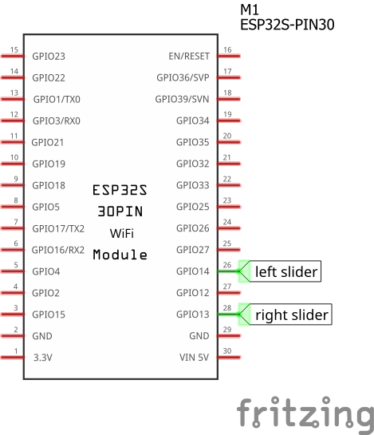
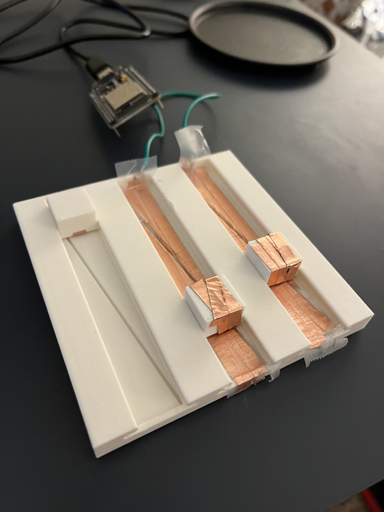

# Lab 4 - Interactive 3D Print
## Inventing Interactive Systems
### Robert Bourque

## Overview

I was more interested in the 3D modelling interactive parts in this project. I wanted to see if I could make sliders with cantilevers that allowed them to be inserted easily without falling out the other side. I figured an easy application without multi-material printing would be capacitive sliders. I put copper tape on some outlined triangles to determine position and then put copper tape on my sliders and inserted them. You can use them to play Pong.

## [Demo Video](https://youtu.be/X5X4E225p0U?si=55xNwrkvjYjDf079)

## Included

 - ESP32 script ("sliders" > "sliders.ino")
 - 3D printing files ("components" > "body.stl", "slider.stl")

## How to Use

1. Recreate the circuit shown in the diagram.
2. Install copper tape to the sliders and body as shown in the image.
3. Upload the code to the ESP32.
   

## AI Use Summary
3D modelled and wrote ESP32 script without assistance. Used AI to make a Pong game from data in Serial.